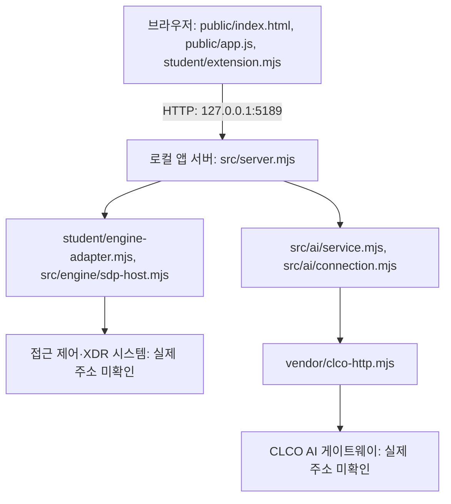

# 케셰브 학생 실행 설명서

## 학생 화면의 「포장 명령과 결과」

「보호 현황」의 학생 기기·세션 영역에 포장 안내를 추가했습니다. 현재 package.json에는 package-app 스크립트가 없고, --finish-materials를 지원하는 최신 제공 포장 도구도 확인하지 못했습니다. 이번 변경은 안내뿐이며 포장 도구·설치 프로그램·바로가기를 만들거나 실행하지 않았습니다.

화면에 표시한 아래 명령은 이미지의 형태를 따른 **실행 전 확인이 필요한 참고 명령**입니다. 현재 프로젝트에서 바로 실행할 수 있는 명령으로 취급하지 않습니다.

```text
npm run package-app -- --source . --out "내 앱 묶음" --finish-materials
```

| 항목 | 이번 작업의 실제 상태 |
|---|---|
| finish.commit.raw | 생성하지 않음 |
| finish.archive.tar.gz | 생성하지 않음 |
| app.zip | 생성하지 않음 |
| APP_PACKAGE_MANIFEST.json | 생성하지 않음 |
| INSTALL.md·설치 묶음 폴더 | 제공 도구 출력 계약 확인 필요·생성하지 않음 |
| 새 경로 설치·바로가기 실행 | 미확인 |
| setup.exe | 만들지 않음. 기본 포장과 구분 |

다음 순서로 진행합니다. 먼저 제공 도구의 실제 위치·사용법·--finish-materials 지원과 package-app 등록 여부를 확인합니다. 그다음 본인 작업 위치에 맞는 --source와 새 출력 폴더를 정하며 원래 폴더·기존 제출물을 덮어쓰지 않습니다. 제공 도구로 동일 커밋의 네 제출 파일을 함께 생성하고 압축을 풀거나 다른 버전의 파일을 섞지 않습니다. 도구의 설치 안내를 확인한 뒤 별도 새 경로에서 설치·바로가기 실행과 학생 화면 반영 여부를 검증합니다. 아직 이 순서를 실제 실행하지 않았습니다.

현재 화면은 사용자가 상태를 읽을 수 있는 안내이며 브라우저에서 셸 명령을 실행하지 않습니다. 화면에서 「포장 명령과 결과」 제목·참고 명령·각 산출물의 미생성 상태를 확인하세요. 학생 DOM만 사용했으며 특정 색상·배치나 설치형 반영은 보장하지 않습니다. 실측값·실행 로그·예시 출력을 혼동하지 않습니다.

## 학생 화면의 「실행 안내 한 장」

「보호 현황」의 학생 기기·세션 영역에 실행 안내를 추가했습니다. 아래 세 단계는 코드·package.json과 대조한 안내이며, 화면 자체가 Node 설치 버전이나 실패 원인을 실제 측정한 것은 아닙니다.

1. 기존 프로젝트의 on-client를 열고 package.json·src/server.mjs가 있는 위치에서 새 터미널을 엽니다. Windows에서는 탐색기 주소 표시줄에 powershell을 입력합니다. 실제 Windows 절대 경로는 사용자가 확인해야 합니다.
2. `node --version` 결과를 요구 버전 24.19.0과 비교합니다. 명령이 없거나 버전이 다르면 설치·실행 경로를 확인합니다. 현재 외부 npm 의존성 선언이 없으므로 임의 설치 명령은 안내하지 않습니다.
3. 같은 폴더에서 `node src/server.mjs`를 실행하고 기본 주소 http://127.0.0.1:5189/ 의 「보호 현황」을 확인합니다. 기존 서버가 실행 중이면 중복 실행하지 않습니다. 종료는 해당 터미널의 Ctrl+C, 재실행은 같은 폴더의 같은 명령입니다.

화면의 기본 주소 링크는 키보드로 접근 가능한 네이티브 링크입니다. 실행 도구 충돌·기본 포장 미구현·설치형 실행 미확인 범위를 숨기지 않습니다. 그림의 예시인 “Node 버전이 달라 멈춤”을 실제 발생한 오류로 표시하지 않았으며, 실제 오류를 확인하기 전에는 원인을 단정하지 않습니다. 지원 환경·실측 결과는 아래 기록과 구분합니다.

이 안내는 student/extension.mjs의 DOM으로 추가했고 제공 화면·스타일·서버·설정은 이번 작업에서 바꾸지 않았습니다. 임의 appearance.json은 만들지 않았습니다. 설치형에서의 정확한 배치·색상·실제 실행은 검증하지 않았습니다.

## 학생 영역의 「다시 조회」·대기·실패 안내

`student/extension.mjs`의 `createStudentView({ api })`가 제공 학생 API를 받아, 보안 기록과 기기·세션 영역에 「다시 조회」 버튼을 표시합니다. 이번 변경 파일은 이 학생 모듈과 이 문서뿐입니다. 제공 공통 화면·서버·인증 설정·기존 로컬 PC 패널은 이번 변경에서 수정하지 않았습니다.

| 영역 | 요청 | 결과와 제한 |
|---|---|---|
| 보안 기록 학생 표시 | GET /api/events | 기존 필터·상세를 유지하고 새 결과로 교체. demo는 예제 자료라고 표시 |
| 기기·세션 학생 표시 | GET /api/devices, GET /api/sessions | 실패 항목을 구분하고 성공한 다른 항목은 표시. 미확인 상태를 정상으로 바꾸지 않음 |
| 제공 알림·진단·AI 설명 대상 | 이 학생 버튼이 요청하지 않음 | 제공 화면에서 전달한 자료와 별개. 전체 갱신은 상단 「다시 불러오기」 등 제공 동선 사용 |
| 로컬 CPU·디스크·Windows·SDP 추가 패널 | 이번 학생 재조회에서 호출하지 않음 | 현재 학생 API 허용 범위 밖. 제공 공통 화면의 추가 기능을 설치형 학생 기능으로 옮겼다고 주장하지 않음 |

대기 중에는 「새로 읽는 중…」을 표시하고 이전 데이터를 현재 결과처럼 남기지 않습니다. 버튼의 aria-disabled와 요청 가드로 중복 요청을 막으며, 버튼 노드를 교체하거나 전체 화면 재렌더를 요청하지 않아 이 재조회 동작 중 키보드 포커스를 유지합니다. 진행 문구는 role=status·aria-live, 결과 영역은 aria-busy로 알립니다. 버튼은 네이티브 button이며 별도 마우스 전용 동작이 없습니다.

실패 시 실패한 항목·안전한 코드와 메시지·다음 행동을 표시합니다. 연결 없음은 담당자에게 연결 준비를 확인하도록 안내하고, 읽기 권한 부족은 관리자 실행이나 설정 변경을 요구하지 않습니다. 예시 데이터로 실패를 대신하지 않습니다. 성공 응답도 자료 형식·출처 모드·응답 시각을 확인하며 PC 실측 시각과 구분합니다. 학생 API가 없는 환경에서는 확인 불가 안내와 사용 불가 상태로 둡니다.

제공 화면에서 새로운 입력이 전달되면 이전 학생 재조회 결과를 버립니다. 늦게 도착한 이전 요청 응답은 표시하지 않습니다. 자동 재시도·자동 주기 조회·POST·디스크 조회는 추가하지 않았습니다. 페이지를 새로 열면 학생 재조회 상태는 초기화됩니다.

현재 student/appearance.json과 해당 파일의 로더·허용 설정 계약은 없습니다. 임의 꾸밈 파일은 만들지 않았습니다. 네이티브 DOM과 제공 학생 API를 사용했지만, npm run package-app도 현재 없어 설치형 앱 포장·실제 반영은 미확인입니다. 특정 색상이나 배치가 설치형에 그대로 반영된다고 보장하지 않습니다.

### 실행과 확인 순서

이미 서버가 실행 중이면 http://127.0.0.1:5189/ 을 새로고침합니다. 서버가 꺼졌으면 이 문서의 앱 폴더·런타임 확인 절차를 따르고 `node src/server.mjs`로 실행합니다. 현재 PC의 번들 Node 경로를 사용하는 실제 실행 명령은 아래 PC 조회 절에도 있습니다.

1. 「보호 현황」 → 학생 「내 앱 · 기기·세션」에서 Tab으로 「다시 조회」에 포커스를 두고 Enter 또는 Space를 누릅니다.
2. 「새로 읽는 중…」과 이전 값 제거를 확인합니다. 대기 중 다시 눌러도 중복 요청이 나가지 않아야 합니다.
3. 현재 기본 미연결 환경에서는 기기·세션 실패 항목과 연결 준비 확인 안내가 보여야 합니다. 정상값·예시값이 나타나면 안 됩니다.
4. 「보안 기록」의 학생 영역에서도 같은 방법으로 확인합니다. 응답을 받으면 실제/예제 표시와 응답 확인 시각을 확인합니다. 제공 AI 설명 대상은 이 학생 버튼만으로 바뀌지 않습니다.

문법과 모의 DOM·요청으로 대기·오류·정상 응답·예제·부분 실패·중복 차단·버튼/포커스 유지·새 입력 우선·늦은 응답 무시를 점검했습니다. 이는 브라우저에서의 실제 키보드·스크린리더·설치형 검증을 대신하지 않습니다. 실제 연결 성공이나 디스크 실측 성공으로 기록하지 않습니다.

실행 중인 로컬 앱의 /api/events·/api/devices·/api/sessions를 실제로 읽어 세 요청의 ENGINE_NOT_CONNECTED 응답을 확인했습니다. 이 실제 응답을 시험 DOM의 학생 버튼에 연결해 실패 항목과 다음 행동이 표시됨을 확인했고, 서버에서 변경한 학생 모듈이 제공되는 것도 확인했습니다. 실제 브라우저 화면·키보드·설치형 동작은 여전히 미확인입니다.

## 학생 추가: PC 구성·Windows 기록·SDP 분리 조회

이 절은 22단계 제출 이후 로컬에서 추가한 기능입니다. 과거 커밋의 재현 결과를 바꾸거나 이 기능까지 과거에 검증했다고 주장하지 않습니다. 제공 로그인·판정·기록 기능은 유지하며 학생 추가 패널과 조회 모듈을 별도로 연결했습니다. 기본 포장 방향은 유지하지만 `npm run package-app`은 아직 구현하지 않았습니다.

| 구분 | 역할 |
|---|---|
| 제공 기능 | 본인 로그인·기기·세션·업무 앱 판정·보안 기록, 기존 CPU·메모리·디스크 학생 패널과 구분 |
| 학생 추가 src/local-pc-security.mjs | 일반 사용자 권한의 인터페이스 주소 조회와 Windows 결과 정규화 |
| 학생 추가 tools/read-pc-security.ps1 | Windows 방화벽 프로필·최근 24시간 System/Application 건수를 읽기만 함 |
| src/server.mjs의 학생 추가 GET 경로 | /api/local-pc-security 및 /api/sdp-status. 기존 인증·판정·집행 설정은 변경하지 않음 |
| public/index.html·app.js·style.css의 학생 추가 | 상단 카드 4개, 상세 표, 항목별 시각·단위·확인 불가 이유, 화면 내 최근 10회 조회 기록 |

네트워크는 로컬 앱 서버 PC의 인터페이스 이름·IPv4/IPv6·주소·CIDR·루프백 여부를 표시합니다. MAC·계정·이벤트 본문은 수집하지 않습니다. 이 목록만으로 인터넷·SDP 연결, DNS·기본 경로의 정상 여부를 판정하지 않습니다.

Windows 방화벽은 프로필별 ActiveStore 설정만 읽습니다. 활성·비활성 설정은 현재 사용 중인 프로필이나 실제 차단 효과를 증명하지 않습니다. 기록은 조회 시작 시 고정한 최근 24시간 구간의 System·Application에서 경고(Level 3)·오류(Level 2)를 각각 건 단위로 집계합니다. 구간·조회 시각을 함께 표시하며, 삭제·순환된 기록은 포함하지 않습니다. **경고·오류 건수는 침해나 공격 탐지 결과가 아닙니다.**

Windows 명령의 기준은 Microsoft 공식 [Get-NetFirewallProfile 문서](https://learn.microsoft.com/en-us/powershell/module/netsecurity/get-netfirewallprofile?view=windowsserver2025-ps)와 [Get-WinEvent 문서](https://learn.microsoft.com/en-us/powershell/module/microsoft.powershell.diagnostics/get-winevent?view=powershell-5.1)입니다. 명령에는 설정 변경·로그 삭제·실행 정책 우회·권한 상승·원격 조회가 없습니다. 실행 정책 때문에 읽지 못해도 정책을 변경하지 않고 확인 불가로 남깁니다. 분류별 실패는 0건으로 바꾸지 않으며 다른 분류의 성공 결과는 유지합니다. 제한 시간 내 끝나지 않는 조회는 전체 집계를 성공으로 표시하지 않습니다.

SDP 카드는 PC 조회와 별도 요청입니다. SDP 호스트 미구성·예제 모드는 「SDP 미연결」, 구성만 있고 실제 호스트 응답을 확인하지 못하면 「SDP 연결 확인 불가」입니다. 실제 SDP 호스트의 본인 정보 응답이 검증된 경우에만 「SDP 응답 확인」으로 표시하며 접근 허용·집행 성공을 뜻하지 않습니다.

### 직접 실행·확인 순서

프로젝트의 on-client 폴더에서 Node.js 요구 버전 24.19.0을 확인하고 다음과 같이 실행합니다. 설치·환경을 임의 변경하지 않습니다.

```text
node --version
node src/server.mjs
```

현재 macOS에서 실제 사용하는 번들 Node는 v24.22.1이며 요구 버전 검증과 구분합니다. 이번 작업의 서버 실행 명령은 아래와 같습니다.

```text
cd /Users/dy/Desktop/test1/on-client
env -i PATH=/usr/bin:/bin /Users/dy/.cache/codex-runtimes/codex-primary-runtime/dependencies/node/bin/node src/server.mjs
```

1. 기존 서버가 실행 중이면 본인이 실행한 서버만 먼저 종료합니다. 중복 실행하지 않습니다.
2. http://127.0.0.1:5189/ 을 열고 「보호 현황」의 상단 카드 4개를 확인합니다.
3. 「PC 구성·SDP 상태 다시 조회」를 누릅니다. 네트워크 주소·방화벽 프로필·Windows 기록 분류마다 실제 결과 또는 확인 불가 이유와 시각을 확인합니다.
4. macOS에서는 Windows 항목이 확인 불가로 표시되는 것이 정상입니다. 0건이나 방화벽 비활성으로 표시되면 안 됩니다. Windows에서는 읽을 권한이 있는 항목만 표시되고 실패해도 관리자 실행을 요구하지 않아야 합니다.
5. SDP 미구성에서는 네트워크·CPU 조회가 성공해도 「SDP 미연결」을 유지해야 합니다. 기존 「보안 기록」은 기존 연결 상태를 그대로 표시해야 합니다.

최초 1회와 사용자 수동 조작 시에만 조회합니다. 새 요청 중에는 이전 상세를 지우며 늦은 응답은 화면을 덮지 않습니다. 조회 이력은 화면 메모리에만 남고 새로고침·종료 시 없어집니다. 과거 추이를 꾸미기 위한 예시 값은 넣지 않습니다. 예시 데이터로 실제 Windows 값을 대체하지 않습니다.

| 확인 범위 | 결과 |
|---|---|
| macOS 일반 사용자 네트워크 조회 | 실제 읽기 성공. 2026-10-26 16:09:12 KST 관측 시 주소 12개. 이후 조회 결과는 달라질 수 있음 |
| macOS Windows 항목 | 실제 반환 상태 WINDOWS_ONLY. 방화벽·System·Application 모두 확인 불가 |
| 실제 로컬 API·SDP 분리 | 임시 로컬 서버에서 PC 조회 성공과 SDP 미연결 동시 확인. CPU 조회·기존 기록의 ENGINE_NOT_CONNECTED 유지 |
| Windows 결과 처리·화면 분기 | 모의 데이터로 0건·권한 부족·부분 실패·알 수 없는 프로필·지연 응답 무시 확인. 실제 Windows 결과가 아님 |
| Windows 조회 명령·권한 부족·시간 초과 | 실제 Windows 환경 검증 미확인. PowerShell 미설치로 실행하지 않음 |
| 브라우저 배치·버튼 조작 | 미확인. HTML·모의 DOM·로컬 HTTP 점검과 구분 |
| 실제 SDP 연결·실집행 | 미확인. 집행·공격·침투 시험은 실행하지 않음 |

설정과 원본 데이터는 읽기만 하며 방화벽·보안 설정을 바꾸지 않습니다. 이 절의 확인 기록은 공식 단계 판정·운영 인증·v1.0 완료를 뜻하지 않습니다.

작성 기준: 2026-10-26, 오늘 변경을 복원한 뒤의 현재 코드. 이 문서는 학생 작성 문서이며 제공 README·문서는 유지합니다. 코드에서 확인한 절차와 실제 실행 결과를 구분합니다.

## 목적과 현재 범위

케셰브는 본인 로그인·기기·세션, 업무 앱 접근 판정과 접속·XDR 기록을 표시합니다. 학생 코드는 제공된 데이터를 화면에 표시하며 서버의 인증·판정·집행을 대신하지 않습니다. 현재 AI 사건 설명은 요약·요청 상태의 기본 표시까지 작성되어 있습니다. 근거 연결 설명 완성, 학생 조치 상태 표시, 학생 취약점 결과 표시는 미완성입니다.

## 필요 프로그램과 확인한 버전

| 항목 | 기준 | 실제 확인 |
|---|---|---|
| Node.js | package.json의 engines.node는 24.19.0 | 현재 macOS 작업 환경에서 v24.22.1 확인. Windows 설치 버전 미확인 |
| PowerShell | Windows에서 아래 절차 실행에 사용 | 버전·실행 미확인 |
| 브라우저 | 로컬 HTTP 화면 열기 | 종류·버전·실제 화면 미확인 |
| 앱 버전 | package.json의 0.2.11 | 파일 대조. 최종 제품 완료 표시가 아님 |
| 의존성 | 제공 README상 외부 npm 의존성 없음 | 이번 작업에서 설치·변경하지 않음 |

Node.js 지원 안내는 package.json의 정확한 요구 버전 24.19.0을 따릅니다. 위 v24.22.1 결과는 macOS에서 관측한 제한된 실행 기록이며, 해당 버전이나 Node.js 22~24 전체의 지원을 검증한 결과가 아닙니다. Windows와 다른 버전은 미확인입니다. 실행 도구의 버전 검사 범위도 지원 범위를 보장하지 않습니다.

## 작업 위치와 구조

현재 로컬 앱 폴더는 `/Users/dy/Desktop/test1/on-client`입니다. Windows의 실제 절대 경로는 미확인입니다. 아래 경로는 앱 폴더 기준입니다.

```text
프로젝트/
└─ on-client/
   ├─ package.json
   ├─ tools/start-alekov.ps1       제공 실행 도구
   ├─ public/index.html, app.js   제공 화면·요청 처리
   ├─ student/extension.mjs       학생 표시 함수
   ├─ student/engine-adapter.mjs  엔진 연결 어댑터
   ├─ src/server.mjs              로컬 앱 서버
   ├─ src/engine/                 접근 제어·XDR 연결
   ├─ src/ai/                     AI 요청·연결·검증
   ├─ src/vulnerabilities/        제공 설치 패키지 조회
   ├─ vendor/clco-http.mjs        AI HTTP 클라이언트
   └─ docs/STUDENT_RUNBOOK.md      이 문서
```

## 실행·종료·재실행

**현재 문제:** 제공 `tools/start-alekov.ps1`의 1·143·285행에 병합 충돌 표시가 있습니다. 따라서 이 파일을 정상 실행 가능한 도구로 안내하지 않습니다. 제공 파일은 보존하고 담당자에게 정상 배포본 확인을 요청합니다.

다음은 `package.json`의 start 스크립트와 같은 진입점을 직접 실행하는 절차입니다. **macOS에서 서버 시작·HTTP 응답·종료·재실행을 확인했습니다. PowerShell은 설치되어 있지 않아 Windows 절차는 미확인입니다.** 직접 실행에는 제공 도구의 폴더·버전·포트 사전 검사가 없습니다.

1. Windows 탐색기에서 본인 프로젝트의 `on-client` 폴더를 엽니다. `package.json`, `src`, `student`가 있는지 확인합니다.
2. 탐색기 주소 표시줄에 `powershell`을 입력하고 Enter를 눌러 그 위치에서 새 창을 엽니다.
3. 다음 명령으로 Node 버전을 확인하고 서버를 실행합니다. 기존 환경 설정이 있으면 결과가 달라질 수 있으므로 임의 설정을 복사하지 않습니다.

```powershell
node --version
node src/server.mjs
```

4. 기본 포트의 시작 메시지는 아래와 같습니다. macOS 점검에서 실제 출력과 일치했습니다. Windows에서는 미확인입니다.

```text
케셰브 연결 확인: http://127.0.0.1:5189
```

5. 브라우저에서 `http://127.0.0.1:5189/`를 엽니다. 제공 안내의 예상 화면은 상단 상태 표시와 「보호 현황」입니다. 시작 로그의 “연결 확인”은 외부 인증·AI 연결 성공의 증거가 아닙니다.
6. 종료는 실행 중인 PowerShell에서 `Ctrl+C`를 누릅니다. 브라우저를 새로고침해 서버가 더 이상 응답하지 않는지 확인합니다. macOS에서는 인터럽트 후 HTTP 응답 중단을 확인했습니다. Windows PowerShell 종료와 브라우저 새로고침은 미확인입니다.
7. 재실행은 같은 앱 폴더에서 새 PowerShell을 열고 3번 명령을 다시 실행합니다. 기존 서버가 남아 있으면 포트 충돌부터 확인합니다. 다른 프로그램을 임의 종료하지 않습니다.

설정 견본은 비밀 없는 `.env.example`입니다. 실제 비밀 파일을 문서·Git·제출물에 넣지 않습니다. 현재 서버 진입점은 프로세스 환경을 읽으며 `.env` 자동 로드는 없습니다. 견본이 있다고 설정이 자동 적용되거나 연동이 승인되지는 않습니다. 실제 연결·조회 대상 설정은 담당자가 준비합니다.

견본의 ON_PORT는 5189, ON_ENGINE_ADAPTER는 ./student/engine-adapter.mjs, ON_AI_MODEL은 aleph/auto이며 ON_PROJECT_DIRECTORY는 비어 있고 ON_APPROVED_PUBLIC_PACKAGES는 빈 목록입니다. 이 값들은 공개 설정 예시이며 실제 연결 자격정보가 아닙니다. 앱 폴더에는 package-lock.json이 없으므로 이 앱의 설치 버전이나 별도 조회 대상 프로젝트의 lock 파일을 확인했다고 기록하지 않습니다. `.env`라는 이름만으로 자동 제외되는 것은 아니며 실제 비밀 파일은 담당자가 정한 제출 제외 보관 방식에 둡니다. 문서 판정을 위해 비밀 파일을 만들거나 제출하지 않습니다.

## 글로 쓴 시스템 구성도



브라우저는 로컬 앱 서버에 요청하고, 서버는 구성된 엔진 어댑터를 통해 접근 판정·기록을 조회합니다. AI 설명은 서버의 AI 서비스와 HTTP 클라이언트를 통해 게이트웨이에 요청됩니다. 학생 함수는 제공 화면이 전달한 결과를 표시합니다. 실제 연결 주소를 확인하지 못했으므로 임의 주소를 적지 않았습니다. 화살표는 코드상의 경로이며 외부 연결 성공을 뜻하지 않습니다. 기본 실행은 실제 시스템 연결을 보장하지 않습니다.

## 학생 구현과 제공 부분

| 파일·함수 | 현재 역할 | 확인 범위 |
|---|---|---|
| student/extension.mjs · renderIdentity | 로그인·기기·세션과 오류·unknown 표시 | 코드 확인 |
| 같은 파일 · renderDecision | 요청 상태와 접근 판정·이유·시각 표시 | 코드 확인 |
| 같은 파일 · renderEvents | 기록 필터·상세, 근거·규칙·상태 표시 | 코드 확인 |
| 같은 파일 · renderStatus | 기기·세션·알림·허용된 진단 정보와 복사 | 코드 확인, 실제 복사 미확인 |
| 같은 파일 · renderAiConnection | 연결 점검 상태·모델 수·점검 시각, 설명 성공과 구분 | 코드 확인 |
| 같은 파일 · renderExplanation | 사건 ID·AI 요약, 요청 중·오류·자료 없음 표시 | 기본 구현. 근거·규칙·현재 상태 연결은 미완성 |
| 같은 파일 · renderAction | 구현 대기 안내 | 미구현 |
| 같은 파일 · renderVulnerabilities | 구현 대기 안내 | 미구현 |
| public/ | 제공 버튼·요청·취소·응답 검증·학생 표시 호출 | 제공 코드, 수정하지 않음 |
| src/, vendor/, student/engine-adapter.mjs | 제공 서버·연결·인증 경계·외부 요청 | 이번 작업에서 수정하지 않음. 실제 연동 미확인 |
| tools/start-alekov.ps1 | 제공 실행 도구 | 충돌 표시 확인. 실행 미확인 |
| docs/STUDENT_RUNBOOK.md | 학생 실행 설명서·구성도·확인 기록 | 이번 작업에서 새로 작성 |

## 오류별 확인 순서

| 상황 | 먼저 확인 | 다음 행동 |
|---|---|---|
| PowerShell 도구 구문 오류 | 실행 도구의 병합 충돌 표시 | 파일을 임의 수정하지 말고 담당자에게 정상 배포본 확인 |
| node 명령을 찾을 수 없음 | Node 설치와 새 창의 실행 경로 | 기준 버전 설치 여부를 확인하고 새 PowerShell에서 재확인 |
| MODULE_NOT_FOUND | 현재 폴더와 src/server.mjs 존재 | 본인 on-client 위치에서 다시 실행 |
| EADDRINUSE | 포트 5189와 기존 실행 창 | 본인이 실행한 서버 여부 확인. 다른 프로세스 임의 종료 금지 |
| 연결 없음·unknown | 화면의 모드·오류 메시지 | 정상으로 단정하지 않고 담당자에게 연결 준비 확인 |
| AI_REQUEST_UNVERIFIED 등 AI 실패 | 안전한 코드·메시지 | 제공 「현재 API 연결 점검」 안내 확인. 실제 설명을 시험 삼아 반복 요청하지 않음 |
| 사건 설명 실패 | 현재 사건과 오류 코드·메시지 | 기존 기록을 확인. AI 해석을 근거 사실로 사용하지 않음 |
| 제공 취약점 화면의 not_configured·not_checked | 조회 대상·승인 목록 준비 여부 | 운영자에게 확인. 학생 취약점 표시는 아직 미구현 |
| 제공 조치 화면의 pending·unknown | ACK와 실제 효과 관측 구분 | 「원천 결과만 재조회」로 결과만 확인. 학생 조치 표시는 아직 미구현 |

실제 보안 조치·유료 AI 요청·설정 변경을 문제 확인 목적으로 임의 실행하지 않습니다. 취약점이 조회되지 않았다는 사실은 앱 전체가 안전하다는 뜻이 아닙니다.

## 실제 확인 결과와 미확인

| 확인 항목 | 결과 |
|---|---|
| 로컬 Node 버전 | 실행 확인: v24.22.1 |
| 학생 코드 문법 | 실행 확인: 종료 코드 0 |
| 함수별 구현 상태·파일 경로 | 코드 대조 |
| macOS 직접 서버 실행 | 실제 시작 메시지, /·/app.js·/student/extension.mjs의 HTTP 200 확인 |
| macOS 종료·재실행 | 인터럽트 후 응답 중단, 재실행 후 HTTP 200, 최종 종료 후 응답 중단 확인 |
| 문서의 버튼 이름 | public/index.html 및 실제 HTTP 응답의 HTML과 일치. 표시·클릭 동작은 미확인 |
| 복원 이전 모의 데이터 검증 | 현재 코드의 검증으로 사용하지 않음 |
| Windows 설치·PowerShell 실행·종료·재실행·브라우저 화면 | 미확인 |
| 접근 제어·XDR 인증·실제 판정·기록 | 기다림(UNV), 실제 연결 미확인 |
| 실제 AI 연결·설명 | 기다림(UNV), 실제 응답 미확인 |
| 실제 조치 집행·효과·결과 재조회 | 기다림(UNV), 학생 표시도 미구현 |
| 실제 설치 버전·OSV 조회 대조 | 기다림(UNV), 학생 표시도 미구현. 앱 폴더에 lock 파일 발견 못 함 |
| 단계 판정·제출 | 미실행. 문서 작성은 통과 판정이 아님 |

이 작업에서 직접 실행한 명령은 아래입니다. macOS 작업 환경의 결과이며 Windows에서 실행한 기록이 아닙니다.

```text
/Users/dy/.cache/codex-runtimes/codex-primary-runtime/dependencies/node/bin/node --version
/Users/dy/.cache/codex-runtimes/codex-primary-runtime/dependencies/node/bin/node --check student/extension.mjs
env -i PATH=/usr/bin:/bin /Users/dy/.cache/codex-runtimes/codex-primary-runtime/dependencies/node/bin/node src/server.mjs
```

서버 실행 작업 폴더는 `/Users/dy/Desktop/test1/on-client`입니다. macOS 점검에서는 기존 연결 설정을 상속하지 않는 환경으로 실행했습니다. 처음에는 샌드박스가 로컬 소켓 접근을 거절했고, 승인된 환경에서 재실행해 위 결과를 확인했습니다. Node HTTP 클라이언트로 응답을 확인하고 별도 점검 스크립트로 서버 재실행·인터럽트 종료를 확인했습니다. 브라우저 자동 실행이나 외부 API 호출은 하지 않았습니다. 점검용 서버는 종료했습니다.

직접 확인할 첫 순서는 본인 Windows 앱 폴더의 새 PowerShell에서 위 직접 실행 절차를 따라 시작 메시지와 「보호 현황」 화면을 확인하는 것입니다. 실제 결과를 기록한 뒤에만 미확인 항목을 갱신합니다.

## 21단계 판정과 제출 절차

현재 과제 안내에 따르면 서버 AI는 제출한 동일 커밋의 README·학생 문서·글로 쓴 구성도·실행 파일·설정 견본을 함께 읽어 코드와 설명의 일치를 판정합니다. 서버가 문서 명령을 실행해 확인하는 단계는 아닙니다. 위 실제 실행 기록은 로컬 확인 범위를 설명하며 서버 판정 통과를 뜻하지 않습니다. 제공 문서의 과거 제출 설명보다 현재 21단계 과제 화면 안내를 우선합니다.

## 21·22단계 커밋과 원문 제출 순서

1. 학생 문서와 이번 단계 코드를 같은 커밋에 저장합니다. 방어전 상황실 4차 탭의 PowerShell 커밋 안내는 13~22단계를 받습니다. 이미 커밋 준비 중인 다른 변경이 있으면 먼저 내용을 확인하고 기존 작업을 보존합니다.
2. 현재 워크벤치의 「포털 제출 준비」는 13~20단계를 지원합니다. 21·22단계에서는 과제 화면에 저장소 주소와 40자리 커밋을 직접 입력합니다. 비공개 저장소를 공개로 바꿀 필요는 없습니다.
3. 비공개 커밋은 해당 단계의 「비공개 저장소 원문 준비 방법」을 펼쳐 「원문 전달 도구 받기」를 누릅니다. ZIP을 프로젝트 밖에 압축 해제하고, JSON을 저장할 프로젝트 밖의 새 폴더도 미리 만듭니다.
4. 제출할 프로젝트의 Git 최상위 폴더에서 PowerShell을 열고 안내된 student-source-cli.mjs 명령을 실행합니다. 도구·출력 파일 경로를 본인 PC에 맞게 바꾸고 --commit 뒤에 제출할 40자리 커밋을 지정합니다. 도구는 커밋된 원문만 묶으며 학생 코드를 실행하거나 업로드하지 않습니다.
5. 생성된 JSON을 같은 단계의 「비공개 저장소 원문 묶음」에서 선택합니다. 저장소·커밋·단계를 다시 확인한 뒤 제출합니다. 원문 전달 완료와 AI 검토 통과는 다르므로 서버 상태와 판정 설명을 확인합니다. 원문 전달만 실패하면 기존 접수를 유지하고 「원문만 다시 보내기」를 사용합니다.

구체적인 도구 명령은 과제 화면의 「비공개 저장소 원문 준비 방법」을 따릅니다. 실제 도구 위치·출력 폴더·Git 최상위·제출할 커밋을 확인한 뒤 명령을 확정합니다. 확인하지 않은 경로와 커밋은 만들지 않습니다. 실제 비밀 파일과 원문 JSON을 저장소에 추가하지 않습니다.

저장소 주소는 https://github.com/darong9494/test1 입니다. 제출 커밋은 이번 문서 커밋이 완료된 후 별도로 확인합니다. 이 문서 작성 중 유료 AI 요청·실제 보안 조치·단계 제출·진도 기록은 실행하지 않습니다.
