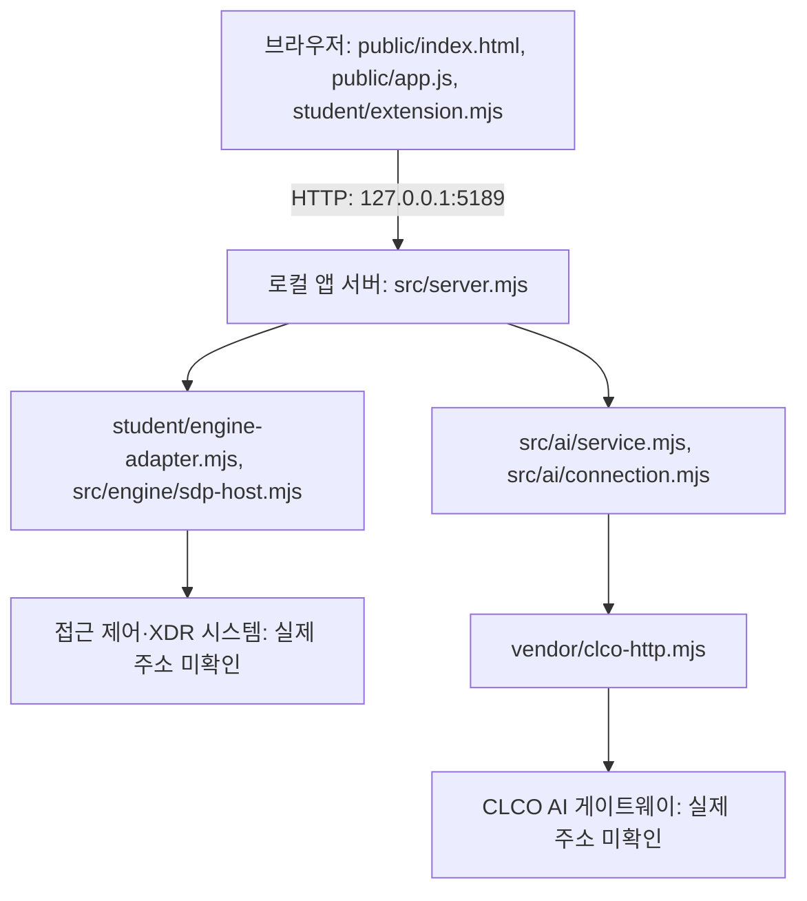

# 케셰브 학생 실행 설명서

작성 기준: 2026-10-26, 오늘 변경을 복원한 뒤의 현재 코드. 이 문서는 학생 작성 문서이며 제공 README·문서는 유지합니다. 코드에서 확인한 절차와 실제 실행 결과를 구분합니다.

## 목적과 현재 범위

케셰브는 본인 로그인·기기·세션, 업무 앱 접근 판정과 접속·XDR 기록을 표시합니다. 학생 코드는 제공된 데이터를 화면에 표시하며 서버의 인증·판정·집행을 대신하지 않습니다. 현재 AI 사건 설명은 요약·요청 상태의 기본 표시까지 작성되어 있습니다. 근거 연결 설명 완성, 학생 조치 상태 표시, 학생 취약점 결과 표시는 미완성입니다.

## 필요 프로그램과 확인한 버전

| 항목 | 기준 | 실제 확인 |
|---|---|---|
| Node.js | package.json의 engines.node는 24.19.0 | 현재 macOS 작업 환경에서 v24.22.1 확인. Windows 설치 버전 미확인 |
| PowerShell | Windows에서 아래 절차 실행에 사용 | 버전·실행 미확인 |
| 브라우저 | 로컬 HTTP 화면 열기 | 종류·버전·실제 화면 미확인 |
| 앱 버전 | package.json의 0.2.11 | 파일 대조. 최종 제품 완료 표시가 아님 |
| 의존성 | 제공 README상 외부 npm 의존성 없음 | 이번 작업에서 설치·변경하지 않음 |

## 작업 위치와 구조

현재 로컬 앱 폴더는 `/Users/dy/Desktop/test1/on-client`입니다. Windows의 실제 절대 경로는 미확인입니다. 아래 경로는 앱 폴더 기준입니다.

```text
프로젝트/
└─ on-client/
   ├─ package.json
   ├─ tools/start-alekov.ps1       제공 실행 도구
   ├─ public/index.html, app.js   제공 화면·요청 처리
   ├─ student/extension.mjs       학생 표시 함수
   ├─ student/engine-adapter.mjs  엔진 연결 어댑터
   ├─ src/server.mjs              로컬 앱 서버
   ├─ src/engine/                 접근 제어·XDR 연결
   ├─ src/ai/                     AI 요청·연결·검증
   ├─ src/vulnerabilities/        제공 설치 패키지 조회
   ├─ vendor/clco-http.mjs        AI HTTP 클라이언트
   └─ docs/STUDENT_RUNBOOK.md      이 문서
```

## 실행·종료·재실행

**현재 문제:** 제공 `tools/start-alekov.ps1`의 1·143·285행에 병합 충돌 표시가 있습니다. 따라서 이 파일을 정상 실행 가능한 도구로 안내하지 않습니다. 제공 파일은 보존하고 담당자에게 정상 배포본 확인을 요청합니다.

다음은 `package.json`의 start 스크립트와 같은 진입점을 직접 실행하는 절차입니다. **macOS에서 서버 시작·HTTP 응답·종료·재실행을 확인했습니다. PowerShell은 설치되어 있지 않아 Windows 절차는 미확인입니다.** 직접 실행에는 제공 도구의 폴더·버전·포트 사전 검사가 없습니다.

1. Windows 탐색기에서 본인 프로젝트의 `on-client` 폴더를 엽니다. `package.json`, `src`, `student`가 있는지 확인합니다.
2. 탐색기 주소 표시줄에 `powershell`을 입력하고 Enter를 눌러 그 위치에서 새 창을 엽니다.
3. 다음 명령으로 Node 버전을 확인하고 서버를 실행합니다. 기존 환경 설정이 있으면 결과가 달라질 수 있으므로 임의 설정을 복사하지 않습니다.

```powershell
node --version
node src/server.mjs
```

4. 기본 포트의 시작 메시지는 아래와 같습니다. macOS 점검에서 실제 출력과 일치했습니다. Windows에서는 미확인입니다.

```text
케셰브 연결 확인: http://127.0.0.1:5189
```

5. 브라우저에서 `http://127.0.0.1:5189/`를 엽니다. 제공 안내의 예상 화면은 상단 상태 표시와 「보호 현황」입니다. 시작 로그의 “연결 확인”은 외부 인증·AI 연결 성공의 증거가 아닙니다.
6. 종료는 실행 중인 PowerShell에서 `Ctrl+C`를 누릅니다. 브라우저를 새로고침해 서버가 더 이상 응답하지 않는지 확인합니다. macOS에서는 인터럽트 후 HTTP 응답 중단을 확인했습니다. Windows PowerShell 종료와 브라우저 새로고침은 미확인입니다.
7. 재실행은 같은 앱 폴더에서 새 PowerShell을 열고 3번 명령을 다시 실행합니다. 기존 서버가 남아 있으면 포트 충돌부터 확인합니다. 다른 프로그램을 임의 종료하지 않습니다.

설정 견본은 비밀 없는 `.env.example`입니다. 실제 비밀 파일을 문서·Git·제출물에 넣지 않습니다. 현재 서버 진입점은 프로세스 환경을 읽으며 `.env` 자동 로드는 없습니다. 견본이 있다고 설정이 자동 적용되거나 연동이 승인되지는 않습니다. 실제 연결·조회 대상 설정은 담당자가 준비합니다.

견본의 ON_PORT는 5189, ON_ENGINE_ADAPTER는 ./student/engine-adapter.mjs, ON_AI_MODEL은 aleph/auto이며 ON_PROJECT_DIRECTORY는 비어 있고 ON_APPROVED_PUBLIC_PACKAGES는 빈 목록입니다. 이 값들은 공개 설정 예시이며 실제 연결 자격정보가 아닙니다. 앱 폴더에는 package-lock.json이 없으므로 이 앱의 설치 버전이나 별도 조회 대상 프로젝트의 lock 파일을 확인했다고 기록하지 않습니다. `.env`라는 이름만으로 자동 제외되는 것은 아니며 실제 비밀 파일은 담당자가 정한 제출 제외 보관 방식에 둡니다. 문서 판정을 위해 비밀 파일을 만들거나 제출하지 않습니다.

## 글로 쓴 시스템 구성도



브라우저는 로컬 앱 서버에 요청하고, 서버는 구성된 엔진 어댑터를 통해 접근 판정·기록을 조회합니다. AI 설명은 서버의 AI 서비스와 HTTP 클라이언트를 통해 게이트웨이에 요청됩니다. 학생 함수는 제공 화면이 전달한 결과를 표시합니다. 실제 연결 주소를 확인하지 못했으므로 임의 주소를 적지 않았습니다. 화살표는 코드상의 경로이며 외부 연결 성공을 뜻하지 않습니다. 기본 실행은 실제 시스템 연결을 보장하지 않습니다.

## 학생 구현과 제공 부분

| 파일·함수 | 현재 역할 | 확인 범위 |
|---|---|---|
| student/extension.mjs · renderIdentity | 로그인·기기·세션과 오류·unknown 표시 | 코드 확인 |
| 같은 파일 · renderDecision | 요청 상태와 접근 판정·이유·시각 표시 | 코드 확인 |
| 같은 파일 · renderEvents | 기록 필터·상세, 근거·규칙·상태 표시 | 코드 확인 |
| 같은 파일 · renderStatus | 기기·세션·알림·허용된 진단 정보와 복사 | 코드 확인, 실제 복사 미확인 |
| 같은 파일 · renderAiConnection | 연결 점검 상태·모델 수·점검 시각, 설명 성공과 구분 | 코드 확인 |
| 같은 파일 · renderExplanation | 사건 ID·AI 요약, 요청 중·오류·자료 없음 표시 | 기본 구현. 근거·규칙·현재 상태 연결은 미완성 |
| 같은 파일 · renderAction | 구현 대기 안내 | 미구현 |
| 같은 파일 · renderVulnerabilities | 구현 대기 안내 | 미구현 |
| public/ | 제공 버튼·요청·취소·응답 검증·학생 표시 호출 | 제공 코드, 수정하지 않음 |
| src/, vendor/, student/engine-adapter.mjs | 제공 서버·연결·인증 경계·외부 요청 | 이번 작업에서 수정하지 않음. 실제 연동 미확인 |
| tools/start-alekov.ps1 | 제공 실행 도구 | 충돌 표시 확인. 실행 미확인 |
| docs/STUDENT_RUNBOOK.md | 학생 실행 설명서·구성도·확인 기록 | 이번 작업에서 새로 작성 |

## 오류별 확인 순서

| 상황 | 먼저 확인 | 다음 행동 |
|---|---|---|
| PowerShell 도구 구문 오류 | 실행 도구의 병합 충돌 표시 | 파일을 임의 수정하지 말고 담당자에게 정상 배포본 확인 |
| node 명령을 찾을 수 없음 | Node 설치와 새 창의 실행 경로 | 기준 버전 설치 여부를 확인하고 새 PowerShell에서 재확인 |
| MODULE_NOT_FOUND | 현재 폴더와 src/server.mjs 존재 | 본인 on-client 위치에서 다시 실행 |
| EADDRINUSE | 포트 5189와 기존 실행 창 | 본인이 실행한 서버 여부 확인. 다른 프로세스 임의 종료 금지 |
| 연결 없음·unknown | 화면의 모드·오류 메시지 | 정상으로 단정하지 않고 담당자에게 연결 준비 확인 |
| AI_REQUEST_UNVERIFIED 등 AI 실패 | 안전한 코드·메시지 | 제공 「현재 API 연결 점검」 안내 확인. 실제 설명을 시험 삼아 반복 요청하지 않음 |
| 사건 설명 실패 | 현재 사건과 오류 코드·메시지 | 기존 기록을 확인. AI 해석을 근거 사실로 사용하지 않음 |
| 제공 취약점 화면의 not_configured·not_checked | 조회 대상·승인 목록 준비 여부 | 운영자에게 확인. 학생 취약점 표시는 아직 미구현 |
| 제공 조치 화면의 pending·unknown | ACK와 실제 효과 관측 구분 | 「원천 결과만 재조회」로 결과만 확인. 학생 조치 표시는 아직 미구현 |

실제 보안 조치·유료 AI 요청·설정 변경을 문제 확인 목적으로 임의 실행하지 않습니다. 취약점이 조회되지 않았다는 사실은 앱 전체가 안전하다는 뜻이 아닙니다.

## 실제 확인 결과와 미확인

| 확인 항목 | 결과 |
|---|---|
| 로컬 Node 버전 | 실행 확인: v24.22.1 |
| 학생 코드 문법 | 실행 확인: 종료 코드 0 |
| 함수별 구현 상태·파일 경로 | 코드 대조 |
| macOS 직접 서버 실행 | 실제 시작 메시지, /·/app.js·/student/extension.mjs의 HTTP 200 확인 |
| macOS 종료·재실행 | 인터럽트 후 응답 중단, 재실행 후 HTTP 200, 최종 종료 후 응답 중단 확인 |
| 문서의 버튼 이름 | public/index.html 및 실제 HTTP 응답의 HTML과 일치. 표시·클릭 동작은 미확인 |
| 복원 이전 모의 데이터 검증 | 현재 코드의 검증으로 사용하지 않음 |
| Windows 설치·PowerShell 실행·종료·재실행·브라우저 화면 | 미확인 |
| 접근 제어·XDR 인증·실제 판정·기록 | 기다림(UNV), 실제 연결 미확인 |
| 실제 AI 연결·설명 | 기다림(UNV), 실제 응답 미확인 |
| 실제 조치 집행·효과·결과 재조회 | 기다림(UNV), 학생 표시도 미구현 |
| 실제 설치 버전·OSV 조회 대조 | 기다림(UNV), 학생 표시도 미구현. 앱 폴더에 lock 파일 발견 못 함 |
| 단계 판정·제출 | 미실행. 문서 작성은 통과 판정이 아님 |

이 작업에서 직접 실행한 명령은 아래입니다. macOS 작업 환경의 결과이며 Windows에서 실행한 기록이 아닙니다.

```text
/Users/dy/.cache/codex-runtimes/codex-primary-runtime/dependencies/node/bin/node --version
/Users/dy/.cache/codex-runtimes/codex-primary-runtime/dependencies/node/bin/node --check student/extension.mjs
env -i PATH=/usr/bin:/bin /Users/dy/.cache/codex-runtimes/codex-primary-runtime/dependencies/node/bin/node src/server.mjs
```

서버 실행 작업 폴더는 `/Users/dy/Desktop/test1/on-client`입니다. macOS 점검에서는 기존 연결 설정을 상속하지 않는 환경으로 실행했습니다. 처음에는 샌드박스가 로컬 소켓 접근을 거절했고, 승인된 환경에서 재실행해 위 결과를 확인했습니다. Node HTTP 클라이언트로 응답을 확인하고 별도 점검 스크립트로 서버 재실행·인터럽트 종료를 확인했습니다. 브라우저 자동 실행이나 외부 API 호출은 하지 않았습니다. 점검용 서버는 종료했습니다.

직접 확인할 첫 순서는 본인 Windows 앱 폴더의 새 PowerShell에서 위 직접 실행 절차를 따라 시작 메시지와 「보호 현황」 화면을 확인하는 것입니다. 실제 결과를 기록한 뒤에만 미확인 항목을 갱신합니다.

## 21단계 판정과 제출 절차

현재 과제 안내에 따르면 서버 AI는 제출한 동일 커밋의 README·학생 문서·글로 쓴 구성도·실행 파일·설정 견본을 함께 읽어 코드와 설명의 일치를 판정합니다. 서버가 문서 명령을 실행해 확인하는 단계는 아닙니다. 위 실제 실행 기록은 로컬 확인 범위를 설명하며 서버 판정 통과를 뜻하지 않습니다. 제공 문서의 과거 제출 설명보다 현재 21단계 과제 화면 안내를 우선합니다.

1. Git 최상위에서 준비 중인 다른 변경을 확인하고 보존한 뒤 학생 문서와 이번 단계 변경을 같은 커밋에 저장합니다. 이번 단계는 문서 변경만 있으며 기존 실행 코드는 유지합니다.
2. 21·22단계는 과제 화면에 저장소 주소와 실제 40자리 커밋을 직접 입력합니다. 현재 워크벤치의 「포털 제출 준비」는 13~20단계를 지원합니다. 비공개 저장소를 공개로 바꿀 필요는 없습니다.
3. 비공개 커밋은 해당 단계의 「비공개 저장소 원문 준비 방법」에서 「원문 전달 도구 받기」를 사용합니다. 도구 ZIP과 출력 JSON용 새 폴더는 프로젝트 밖에 둡니다.
4. 제출 프로젝트의 Git 최상위에서 PowerShell을 열고 과제 화면의 student-source-cli.mjs 명령을 사용합니다. 도구·출력 경로와 --commit 값은 본인 PC와 실제 커밋을 확인해 지정합니다. Windows 경로와 구체적인 도구 명령은 아직 미확인이므로 추측한 명령은 적지 않습니다. 도구는 커밋된 원문을 묶으며 학생 코드를 실행하거나 업로드하지 않습니다.
5. 생성 JSON을 같은 단계의 「비공개 저장소 원문 묶음」에서 선택하고 저장소·커밋·단계를 확인한 뒤 사용자가 제출합니다. 원문 전달 완료와 AI 검토 통과는 다릅니다. 원문 전달만 실패하면 기존 접수를 유지하고 「원문만 다시 보내기」를 사용합니다.

저장소 주소는 https://github.com/darong9494/test1 입니다. 제출 커밋은 이번 문서 커밋이 완료된 후 별도로 확인합니다. 이 문서 작성 중 유료 AI 요청·실제 보안 조치·단계 제출·진도 기록은 실행하지 않습니다.
