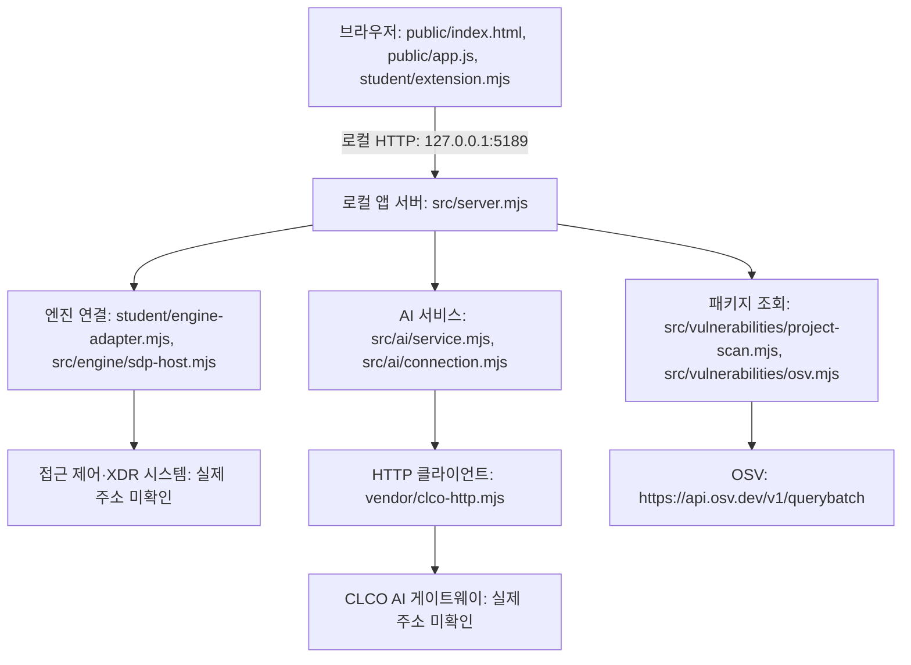

# 케셰브 학생 운영 문서

이 문서는 학생 구현과 확인 기록입니다. 제공 README와 실행 안내를 대체하지 않습니다. 기준 확인일은 2026-10-26입니다. 아래에서 **실행 확인**, **코드 확인**, **미확인**을 구분합니다.

## 목적과 기능

케셰브는 본인 로그인·기기·세션, 업무 앱 접근 판정, 접속·XDR 기록을 표시하는 보안 Agent입니다. AI 설명은 근거를 읽는 참고 정보이며, 조치 제안·요청 접수·실제 효과 확인은 구분합니다. 설치 패키지는 정확한 버전의 알려진 취약점 조회 결과를 표시합니다. 실제 시스템 연동과 인증·집행 성공은 미확인입니다. 앱 버전은 package.json의 0.2.11이며 학생 최종 제품 v1.0 완료를 뜻하지 않습니다.

## 준비 환경과 폴더

| 항목 | 기준 또는 확인 결과 |
|---|---|
| Node.js | package.json 기준 24.19.0. 제공 실행 도구는 22~24를 검사합니다. 이번 macOS 작업 환경에서 직접 확인한 버전은 v24.22.1입니다. Windows 설치 버전은 미확인입니다. |
| PowerShell | 제공 Windows 실행 도구에 필요합니다. 설치 버전과 실행 결과는 미확인입니다. |
| 브라우저 | 로컬 주소를 열 수 있는 브라우저가 필요합니다. 종류·버전과 실제 화면 실행은 미확인입니다. |
| 패키지 설치 | 제공 README상 외부 npm 의존성은 없습니다. 이번 작업에서 설치·버전 변경은 하지 않았습니다. |
| 작업 폴더 | 현재 파일 위치는 `/Users/dy/Desktop/test1/on-client`입니다. Windows에서는 본인 프로젝트의 `on-client` 폴더를 사용합니다. Windows 절대 경로는 확인하지 않았습니다. |

```text
프로젝트/
└─ on-client/
   ├─ package.json                실행 스크립트와 기준 버전
   ├─ tools/start-alekov.ps1       제공 PowerShell 실행 도구
   ├─ src/server.mjs              로컬 앱 서버
   ├─ src/engine/                 접근 제어·XDR 연결
   ├─ src/ai/                     AI 연결·응답 검증
   ├─ src/vulnerabilities/         설치 메타데이터 대조·OSV 조회
   ├─ public/                     제공 화면과 요청 상태 관리
   ├─ student/extension.mjs        학생 화면 함수
   ├─ student/engine-adapter.mjs   제공 엔진 어댑터 진입점
   └─ docs/STUDENT_RUNBOOK.md      이 문서
```

현재 작업 폴더에서는 `package-lock.json`을 발견하지 못했습니다. OSV 조회 대상 프로젝트의 lock 파일과 설치 버전 대조는 미확인입니다. 조회 대상 경로와 허용 패키지는 운영자가 준비하며 학생이 임의로 바꾸지 않습니다.

## 실행·종료·재실행

**현재 실행 도구 문제:** `tools/start-alekov.ps1`의 1·143·285행에 병합 충돌 표시가 남아 있습니다. GitHub 원문에도 같은 문제가 있습니다. 제공 안내의 스크립트 명령을 현재 정상 실행 절차로 사용하지 않습니다. 제공 파일은 보존하고 담당자에게 정상 배포본 확인을 요청합니다.

아래는 package.json의 start 스크립트와 같은 서버 진입점을 직접 실행하는 절차입니다. **코드에서 확인했으며 이번 환경에서 서버 실행은 하지 않았습니다.** PowerShell 실행 성공 기록으로 간주하지 않습니다. 도구 복구 후 사용법은 [STUDENT_LAUNCH_GUIDE.md](STUDENT_LAUNCH_GUIDE.md)를 참조합니다.

1. Windows 파일 탐색기에서 본인 프로젝트의 `on-client`를 엽니다. `package.json`, `src`, `tools`, `student`가 있는 위치인지 확인합니다.
2. 탐색기 주소 표시줄에 `powershell`을 입력해 해당 폴더에서 창을 엽니다.
3. 다음 명령을 실행합니다.

```powershell
node --version
node src/server.mjs
```

4. 첫 명령으로 설치 버전을 확인합니다(기준 24.19.0). 둘째 명령은 서버를 실행합니다. src/server.mjs 코드의 예상 기본 시작 신호는 다음과 같습니다. 실제 출력은 미확인입니다. 기존 셸의 환경 설정에 따라 포트·모드·연결 결과가 달라질 수 있습니다.

```text
케셰브 연결 확인: http://127.0.0.1:5189
```

5. 브라우저에서 `http://127.0.0.1:5189/`를 엽니다. 제공 안내의 예상 화면은 상단 상태 표시와 「보호 현황」입니다. 로컬 서버 응답은 접근 제어 시스템·AI 연결 성공의 증거가 아닙니다.
6. 종료하려면 실행한 PowerShell 창에서 `Ctrl+C`를 누릅니다. 브라우저 새로고침으로 서버가 더 이상 응답하지 않는지 확인합니다. 이번 작업에서 종료 동작은 미확인입니다.
7. 재실행하려면 같은 `on-client` 폴더에서 새 PowerShell 창을 열어 3번 명령을 다시 실행합니다. 이미 실행 중인 서버가 있다면 포트 충돌 여부부터 확인합니다.

직접 실행은 제공 도구의 버전·폴더·포트 사전 검사를 대신하지 않습니다. 자동 설치나 임의 프로세스 종료는 하지 않습니다.

이 작업에서 실제 실행한 명령은 아래 두 개입니다. 실행 환경은 macOS이며 PowerShell 실행 기록이 아닙니다.

```text
/Users/dy/.cache/codex-runtimes/codex-primary-runtime/dependencies/node/bin/node --version
/Users/dy/.cache/codex-runtimes/codex-primary-runtime/dependencies/node/bin/node --check student/extension.mjs
```

첫 명령은 `v24.22.1`, 둘째는 종료 코드 0을 확인했습니다. 문법 검사는 서버 기동·인증·화면 동작을 검증하지 않습니다.

## 설정 견본

`.env.example`은 비밀 없는 견본입니다. 기본 포트 5189, 엔진 어댑터 경로, AI 모델 이름, 빈 프로젝트 조회 경로와 공개 조회 승인 목록 예시가 있습니다. 파일이 존재한다고 자동 적용되거나 연결이 승인되지는 않습니다. `src/server.mjs`는 프로세스 환경을 읽고 이 진입점에는 `.env` 자동 로드가 없습니다. 대상 경로·허용 패키지·호스트 연결은 운영자가 준비합니다. 비밀값은 담당자가 정한 제출 제외 저장 방식에 보관하고 문서·Git·제출 묶음에 포함하지 않습니다.

실제 `.env`는 문서 판정을 위한 제출물이 아닙니다. 이 프로젝트의 설정 견본은 `on-client/.env.example`이며 키·토큰·비밀번호 없이 함께 읽을 수 있습니다. `.env`라는 이름만으로 Git에서 자동 제외되는 것은 아닙니다. 현재 on-client에는 별도의 `.gitignore`가 없으므로 실제 비밀 파일을 만들거나 추가하지 않습니다. 향후 필요한 비밀값은 담당자가 지정한 제출 제외 파일·보관함에 두고, 실제 제외 여부를 확인해야 합니다. `.env.example`에 실제 값을 채우거나 비밀값을 문서에 붙여 넣지 않습니다.

## 21단계 판정 범위와 근거 위치

서버 AI는 **제출한 동일 커밋**의 README·학생 문서·글로 쓴 구성도·실행 파일·설정 견본을 함께 읽어 설명과 코드의 일치를 판정합니다. 서버가 문서의 명령을 실행해 확인하는 단계가 아닙니다. 아래 표는 근거 위치를 안내하며, 서버의 통과 판정을 대신하지 않습니다. 실행 미확인 표시는 실제 동작의 확인 범위이며 문서나 소스가 없다는 뜻은 아닙니다.

| 항목 | 문서 근거 | 같은 커밋에서 대조할 원문(on-client 기준) |
|---|---|---|
| documentation_scope | README 학생 작성 부분, 이 문서의 목적·환경·구성 | README.md, package.json |
| run_instructions_match_source | 실행·종료·재실행, 실행 도구 충돌 경고 | package.json의 start, src/server.mjs의 시작 코드, tools/start-alekov.ps1 |
| architecture_matches_source | Mermaid와 텍스트 구성도 | public/app.js, src/server.mjs, student/engine-adapter.mjs, src/engine/sdp-host.mjs, src/ai/service.mjs, vendor/clco-http.mjs |
| provided_student_boundary | 학생 구현과 제공 코드의 경계 표 | student/extension.mjs, public/, src/, tools/ |
| failure_guide_matches_source | 오류별 확인 순서 | student/extension.mjs의 상태 분기, public/app.js의 요청·취소, src/server.mjs의 오류 처리 |
| support_scope_honest | 확인 기록과 기다림(UNV), 설정 견본 | package.json, .env.example, 실제 확인 기록과 각 모듈의 지원 범위 |

제공 안내의 과거 판정 설명과 현재 과제 화면이 다르면 현재 21단계 안내를 기준으로 합니다. 명령 실행 성공·외부 연결·단계 통과를 추측해 기록하지 않습니다.

## 글로 쓴 구성도

모듈 경로는 on-client 기준입니다. 아래는 연결이 구성된 경우의 코드 경로이며 실제 연결 성공을 뜻하지 않습니다.




```text
브라우저: http://127.0.0.1:5189/
  public/index.html + public/app.js + student/extension.mjs
          │ 로컬 HTTP 요청
          ▼
로컬 앱 서버: src/server.mjs (127.0.0.1에 바인딩)
          ├─ student/engine-adapter.mjs → src/engine/sdp-host.mjs
          │       → 접근 제어·XDR 시스템 (실제 연결 주소 미확인)
          ├─ src/ai/service.mjs + src/ai/connection.mjs
          │       → vendor/clco-http.mjs → CLCO AI 게이트웨이 (실제 주소 미확인)
          └─ src/vulnerabilities/project-scan.mjs → src/vulnerabilities/osv.mjs
                  → OSV 공개 조회: https://api.osv.dev/v1/querybatch
```

브라우저는 로컬 서버에 요청하고, 접근 판정·기록 조회와 AI 요청은 서버의 각 연결 경로로 처리합니다. 학생 렌더 함수는 전달된 결과를 표시합니다. 기본 실행은 실제 시스템 연결을 보장하지 않습니다. 위 화살표는 코드상의 경로이며 외부 연결 성공을 관측한 결과가 아닙니다. OSV 주소는 소스에서 확인한 공개 주소이며 이번 작업에서 요청하지 않았습니다. 인증 설정·토큰·비밀번호·API 키는 문서에 포함하지 않습니다.

## 학생 구현과 제공 코드의 경계

| 파일·함수 | 역할 | 확인 범위 |
|---|---|---|
| student/extension.mjs · renderIdentity | 로그인·기기·세션과 확인 불가 상태 표시 | 코드 확인 |
| 같은 파일 · renderDecision | 접근 판정과 요청 실패를 구분하고 이유·시각 표시 | 코드 확인 |
| 같은 파일 · renderEvents | 기록 필터·상세, 근거·규칙·상태 표시 | 코드 확인 |
| 같은 파일 · renderStatus | 기기·세션·알림·허용된 진단 정보와 복사 표시 | 코드 확인 |
| 같은 파일 · renderAiConnection | 연결 점검과 사건 설명 성공을 구분 | 코드 확인 |
| 같은 파일 · renderExplanation | 현재 기록의 근거 ID 대조, 규칙·unknown·미실행 제안 표시 | 모의 입력 검증, 실제 AI 응답 미확인 |
| 같은 파일 · renderAction | 준비·전송·ACK·효과 관측을 구분. succeeded 및 effectApplied===true에서만 효과 확인 | 모의 입력 검증, 실제 집행 미확인 |
| 같은 파일 · renderVulnerabilities | 정확한 버전·조회 상태·출처·시각·부분 취약점 결과 표시 | 모의 입력 검증, 실제 설치·OSV 대조 미확인 |
| public/app.js | 제공 버튼, 요청 시작·취소·요청 세대 비교·학생 함수 호출 | 제공 파일 유지. 취약점 요청 함수는 모의 네트워크로 지연 응답·재조회 검증 |
| src/server.mjs, src/engine/, src/ai/, src/vulnerabilities/, vendor/ | 서버 처리·인증 경계·응답 검증·외부 조회 | 제공 파일 유지. 실제 연결 성공 미확인 |
| tools/start-alekov.ps1, public/index.html | 실행 도구와 제공 화면 | 제공 파일 유지. 실행 도구에 병합 충돌 표시 확인. 실행·화면 동작 미확인 |

학생 코드에는 보안 조치 POST·인증 티켓·실행 버튼을 추가하지 않았습니다. 제공 조치 화면의 취소는 이미 전달된 조치 효과를 되돌리지 않습니다. 취약점의 이전 응답 차단은 학생 함수가 아니라 제공 요청 코드의 세대 비교에서 수행합니다.

## 오류별 확인 순서

| 표시·상태 | 먼저 확인할 것 | 다음 행동 |
|---|---|---|
| PowerShell 도구 구문 오류 | start-alekov.ps1의 충돌 표시 | 제공 파일 복구를 담당자에게 요청. 위 직접 실행 절차도 실제 실행은 미확인 |
| 직접 실행 시 EADDRINUSE | 포트 5189와 기존 서버 | 다른 프로세스를 임의 종료하지 말고 본인 실행 여부 확인 |
| Node.js가 없음·버전 범위 오류 | 새 PowerShell 창과 설치 버전 | 제공 실행 안내의 Node.js 기준 확인. 임의 설치 성공을 가정하지 않음 |
| 앱 폴더가 아님 | 현재 폴더에 package.json·tools·src가 있는지 | 본인 on-client에서 다시 시작 |
| 포트 5189 사용 중 | 기존 케셰브 실행 창이 있는지 | 다른 프로세스를 임의 종료하지 말고 제공 실행 안내 확인 |
| 연결 없음·확인 불가 | 예제/실제 연결 상태와 담당자 설정 여부 | unknown을 정상으로 바꾸지 말고 담당자에게 확인 |
| AI_REQUEST_UNVERIFIED·권한 준비 중 | 화면의 안전한 오류 코드·메시지 | 「현재 API 연결 점검」 등 제공 동선 확인. 비밀값을 복사하거나 요청을 반복하지 않음 |
| AI 설명 실패·근거 불일치 | 현재 기록 ID와 근거 ID | 설명을 사실로 사용하지 않음. 기존 판정·기록 유지 여부 확인 |
| 조치 pending·unknown | ACK인지 효과 관측인지, 요청·영수증 ID | 「원천 결과만 재조회」로 결과만 확인. 새 집행을 시험하지 않음 |
| 취약점 조회 실패·취소 | 안전한 메시지와 이전 표 제거 여부 | 보호 현황의 「설치 패키지 조회」를 직접 눌러 새 조회. 자동 재시도 없음 |
| not_configured | 조회 대상 프로젝트 설정 여부 | 대상 경로·허용 패키지 준비를 운영자에게 확인 |
| not_checked | 승인된 공개 조회 대상이 없는 등의 미조회 이유 | 운영자에게 대상 준비 확인. 취약점 없음으로 해석하지 않음 |
| partial·unverifiable | 실패한 패키지와 이미 받은 취약점 ID | 일부 결과 보존. 전체 조회 성공·안전으로 판단하지 않음 |
| none_found | 정확한 버전·조회 출처·시각 | 조회 범위에서 알려진 항목이 없다는 뜻으로만 해석 |

문제 해결을 위해 의존성을 임의로 낮추거나 조회 대상·인증 설정을 변경하지 않습니다. 도움정보는 내용을 검토하고 비밀값이 포함되지 않았는지 확인합니다.

## 확인 기록과 기다림(UNV)

| 항목 | 결과 |
|---|---|
| Node 버전·학생 코드 문법 | 실행 확인: v24.22.1, 문법 검사 종료 코드 0 |
| 설명·조치·취약점 학생 표시 | 모의 데이터로 상태·근거 연결·부분 결과·새 표시 교체 확인 |
| 취약점 실패 후 새 요청 | 제공 요청 함수를 모의 네트워크로 실행해 새 요청·복구 확인 |
| 취약점 늦은 응답 차단 | 제공 요청 함수를 모의 네트워크로 실행해 취소·새 요청·초기화 뒤 이전 응답 배제 확인 |
| Windows 새 PowerShell에서 시작·종료·재실행 | 기다림(UNV). 버전·실행 출력·브라우저 화면 미확인 |
| 접근 제어·XDR 인증 및 실제 판정·기록 | 기다림(UNV). 실제 연결 성공 미확인 |
| 실제 AI 연결·유료 설명 응답 | 기다림(UNV). 확인 목적으로 요청하지 않음 |
| 실제 대상의 조치 집행·효과·재조회 | 기다림(UNV). 연동 준비와 실제 관측 미확인 |
| 실제 lock 파일·node_modules·OSV 결과 일치 | 기다림(UNV). 실제 조회·패키지 버전 대조 미확인 |
| 실제 화면에서 조회 취소·오류 후 복구·새로고침 | 기다림(UNV). 모의 검증과 구분 |
| 공식 단계 통과·진도 기록 | 미확인. 이 문서 작성 중 제출하거나 기록하지 않음 |

직접 확인할 첫 순서는 본인 Windows `on-client` 폴더의 새 PowerShell에서 위 직접 서버 실행 절차를 따라 실제 시작 메시지와 브라우저의 「보호 현황」이 나타나는지 기록하는 것입니다. 충돌 표시가 남은 실행 도구는 사용하지 않습니다. 결과를 확인한 뒤에만 이 문서의 미확인 항목을 갱신합니다.

## 21단계 커밋과 원문 제출

이번 단계는 학생 문서 변경이며 실행 코드는 변경하지 않습니다. Git 최상위에서 다른 준비 중인 변경을 먼저 확인하고, 앞 단계 코드를 보존한 같은 커밋에 학생 문서를 저장합니다. 현재 로컬 폴더에는 Git 메타데이터가 없어 여기서 Git 최상위나 Windows 경로를 확정할 수 없습니다. 저장소는 https://github.com/darong9494/test1 이며 실제 제출할 40자리 커밋은 커밋 완료 후 별도로 확인합니다.

21·22단계는 과제 화면에 저장소 주소와 40자리 커밋을 직접 입력합니다. 현재 워크벤치의 「포털 제출 준비」는 13~20단계용입니다. 제공 실행 안내의 과거 제출 설명보다 현재 과제 화면 안내를 우선합니다.

비공개 원문이 필요하면 해당 단계의 「비공개 저장소 원문 준비 방법」에서 「원문 전달 도구 받기」를 사용합니다. ZIP은 프로젝트 밖에 압축 해제하고 출력 JSON용 새 폴더도 프로젝트 밖에 만듭니다. 제출 프로젝트의 Git 최상위에서 PowerShell을 열고 과제 화면의 student-source-cli.mjs 명령을 사용합니다. 도구·출력 경로와 --commit 값은 본인 PC와 실제 커밋을 확인한 뒤 정합니다. 현재 그 경로와 상세 도구 명령은 미확인이므로 임의 명령을 작성하지 않습니다.

JSON을 「비공개 저장소 원문 묶음」에서 선택하고 저장소·커밋·단계를 확인한 뒤 사용자가 제출합니다. 원문 전달 완료와 AI 검토 통과는 다릅니다. 원문만 실패하면 기존 접수를 유지하고 「원문만 다시 보내기」를 사용합니다. 이 문서 작성 중 제출·진도 기록은 실행하지 않습니다. 현재 안내상 서버는 커밋 원문을 읽어 판정하며 문서 명령을 실행하지 않습니다.
